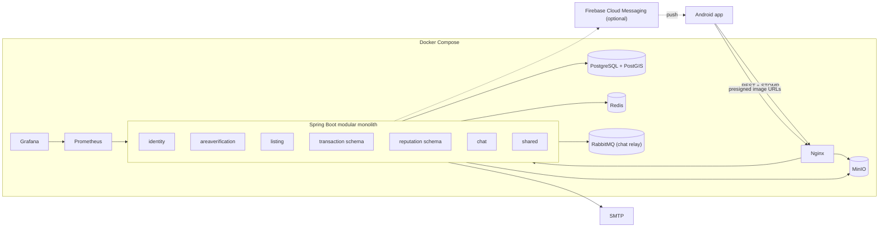

# Nearby backend

Nearby is an Android-first marketplace for buying and selling second-hand goods in GPS-verified areas. This repository contains the backend for the SE114 Introduction to Mobile Applications project by team Prompt AI. It uses Java 25, Spring Boot 4.1, Spring Modulith, and PostgreSQL with PostGIS.

## Quick start

Install **JDK 25** and start **Docker with Docker Compose**. On the first run, copy the development configuration and start the app from the repository root.

**Linux and macOS**

```sh
cp .env.example .env
./gradlew bootRun
```

**Windows PowerShell**

```powershell
Copy-Item .env.example .env
.\gradlew.bat bootRun
```

Spring Boot starts PostGIS (host port `5433`), Redis, RabbitMQ, and MinIO through Docker Compose. Flyway applies the database migrations and loads reference data on startup.

- [Swagger UI](http://localhost:8080/swagger-ui.html) · [Health check](http://localhost:8080/actuator/health)
- [Android emulator and device configuration](docs/setup-local.md#6-calling-the-api-from-the-android-app)
- [Load the optional W03-C demo seed](docs/setup-local.md#load-sample-listings-for-database-tests)

## Modules and API contracts

REST endpoints use `/api/v1`. Use a bearer access token for protected endpoints and follow the individual API contracts for actions that require an `Idempotency-Key`. Chat uses STOMP over `/ws`.

| Module | What it handles | Reference |
| --- | --- | --- |
| `identity` | Phone-first accounts, sessions, profiles, consent, blocks, and administration | [Identity API](docs/api/identity-api.md) |
| `areaverification` | GPS area verification, renewal, and active area selection | [Area API](docs/api/area-api.md) |
| `listing` | Categories, listing management, image processing, favorites, nearby search, and filters | [Listing API](docs/api/listing-api.md) |
| `chat` | Conversations, messages, notifications, and push integration | [Chat and Notification API](docs/api/chat-api.md) · [STOMP frames](docs/api/chat-stomp.md) |
| `transaction` and `reputation` | Database schema for future transaction and reputation services | [Flyway migrations](src/main/resources/db/migration/) |
| `shared` | Security, error handling, storage, and common web utilities | [Code structure](docs/setup-local.md#5-code-structure) |

Import the [Postman collections and local environment](docs/postman/) to try the API. The [OpenAPI definition](docs/api/openapi.yml) is also available in the repository.

## Architecture

The diagram shows the deployment layout. Local development calls Spring Boot directly. Firebase Cloud Messaging is optional and uses the configuration described in [local setup](docs/setup-local.md#92-firebase-cloud-messaging-real-push-fr-nt-02).



## Build and test

```sh
./gradlew build
```

On Windows, run `.\gradlew.bat build`. Keep Docker running for Testcontainers. The build checks tests, Spring Modulith boundaries, Java formatting, and JaCoCo line coverage (60% overall and 80% for domain and application packages). Run `./gradlew format` if the formatting check reports changes.

- [Local setup and troubleshooting](docs/setup-local.md)
- [GitHub Actions and coverage reports](docs/setup-ci.md)
- [Deployment guide](deploy/README.md)
